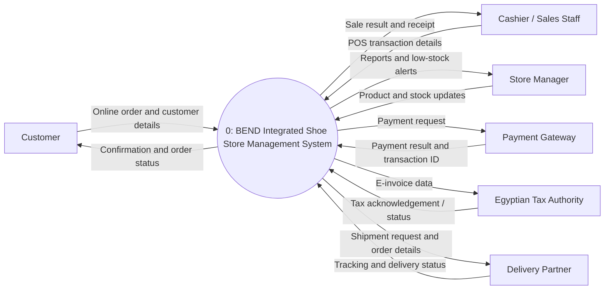
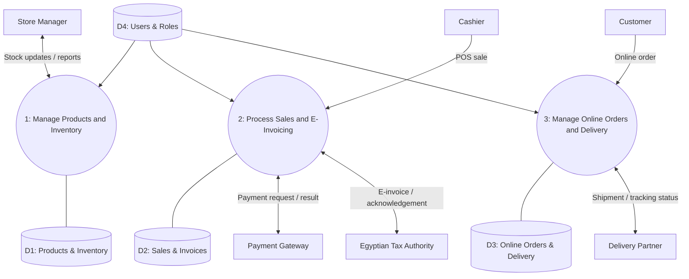
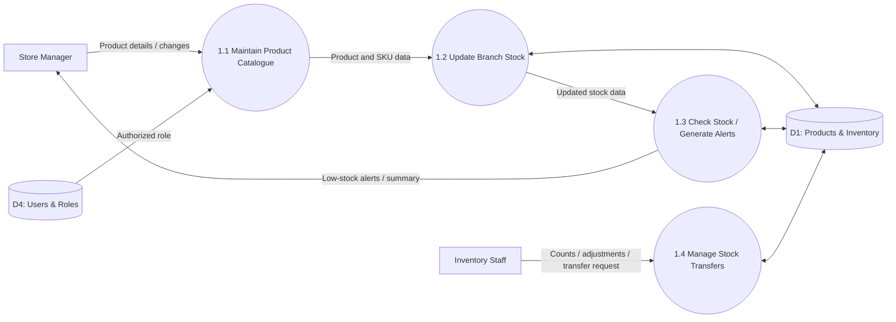
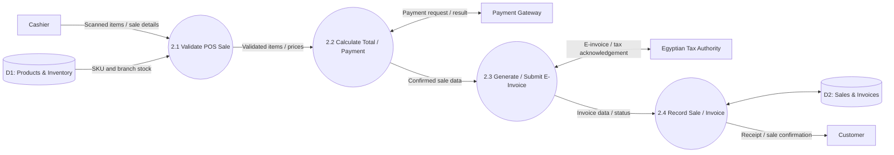
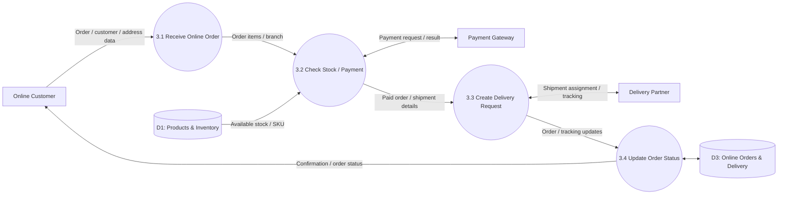

# Task 9 – Data Flow Diagrams (DFD)

**Project:** BEND Integrated Shoe Store Management System  
**Course:** System Analysis and Design

## 1. Introduction
This task models how information enters, moves through, is processed by, and is stored in the BEND system. The model covers coordinated retail operations across the three branches and keeps external provider processing outside the BEND system boundary.

## 2. External Entities
| External Entity | Role |
|---|---|
| Customer | Places online orders and receives confirmations, payment outcomes and delivery updates. |
| Cashier / Sales Staff | Records in-store POS transactions and issues receipts. |
| Store Manager | Maintains product and branch information and reviews inventory and operational reports. |
| Inventory Staff | Records counts, adjustments and inter-branch stock transfers. |
| Payment Gateway | Processes payment requests and returns payment results and transaction references. |
| Egyptian Tax Authority | Receives electronic invoice data and returns acknowledgement or validation status. |
| Delivery Partner | Receives shipment requests and returns tracking and delivery status. |

## 3. Data Stores
| ID | Data Store | Main Contents |
|---|---|---|
| D1 | Products & Inventory | Product catalogue, SKU attributes (brand, colour, size), branch stock, adjustments and transfers. |
| D2 | Sales & Invoices | POS sales, totals, payment references, invoice data and tax submission status. |
| D3 | Online Orders & Delivery | Online orders, delivery details, courier assignment and tracking updates. |
| D4 | Users & Roles | User accounts, role permissions and branch-level access settings. |

## 4. Context Level DFD
The complete BEND system is represented as process 0. Customers, cashiers and store managers exchange operational information with the system. The system also exchanges payment data with the payment gateway, e-invoice data with the Egyptian Tax Authority, and shipment/tracking data with delivery partners. No data stores are shown at this level.

## 5. Diagram 0 – Major Processes
- **1. Manage Products and Inventory:** maintains products and SKU information, branch stock, stock alerts and inter-branch transfers using D1.
- **2. Process Sales and E-Invoicing:** validates POS items, processes payments and generates electronic invoices; records completed sales and invoice status in D2.
- **3. Manage Online Orders and Delivery:** receives online orders, checks stock and payment, coordinates courier shipment and tracks order status in D3.
- **D4** supports user and role validation.

## 6. Child Diagram – Process 1: Manage Products and Inventory
- **1.1 Maintain Product Catalogue:** maintains product details and SKU attributes such as brand, colour and size.
- **1.2 Update Branch Stock by SKU:** records quantities by branch after counts and approved adjustments.
- **1.3 Check Stock Levels and Generate Alerts:** checks configured thresholds and prepares inventory summaries and low-stock alerts.
- **1.4 Manage Inter-Branch Stock Transfers:** records transfer requests and resulting stock movements in D1.
- D4 is used to validate user roles and access permissions.

## 7. Child Diagram – Process 2: Process Sales and E-Invoicing
- **2.1 Receive POS Sale and Validate Items:** receives cashier sale details and validates items against current product and branch-stock data in D1.
- **2.2 Calculate Total and Process Payment:** calculates the total and exchanges payment requests/results with the external payment gateway.
- **2.3 Generate E-Invoice and Submit to Tax:** submits invoice data to the Egyptian Tax Authority and receives acknowledgement or validation status.
- **2.4 Record Sale and Invoice Status:** stores the sale, payment reference, invoice details and tax status in D2 and provides the receipt.

## 8. Child Diagram – Process 3: Manage Online Orders and Delivery
- **3.1 Receive Online Order:** receives the order and customer delivery information.
- **3.2 Check Availability and Confirm Payment:** checks D1 and coordinates payment authorization with the payment gateway.
- **3.3 Create Delivery Request:** sends shipment details to the delivery partner and receives tracking information.
- **3.4 Update Order and Delivery Status:** stores order and fulfilment updates in D3 and provides order status to the customer.

## 9. DFD Consistency Notes
1. The Context Diagram contains one process (0) and does not show data stores.
2. Diagram 0 decomposes process 0 into processes 1, 2 and 3.
3. Child processes use parent numbering (for example, 1.1, 2.3 and 3.4).
4. Data stores connect to processes, not directly to external entities.
5. The payment gateway, Egyptian Tax Authority and delivery partners remain external to BEND.
6. Every data flow is labelled and arrows indicate direction.
7. Child diagrams preserve the major inputs and outputs of their parent processes (balancing).
8. Inventory information is checked before confirming sales or online orders.

## 10. Modelling Assumptions
The DFDs cover product and SKU management, branch inventory, stock transfers, POS sales, online orders, payment status handling, e-invoicing, delivery tracking, reporting and role-based access. They do not model the internal operation of the payment gateway, tax platform or courier systems. Detailed API fields, database table structures and screen-level workflows are reserved for detailed design.

---
**End of Task 9**
